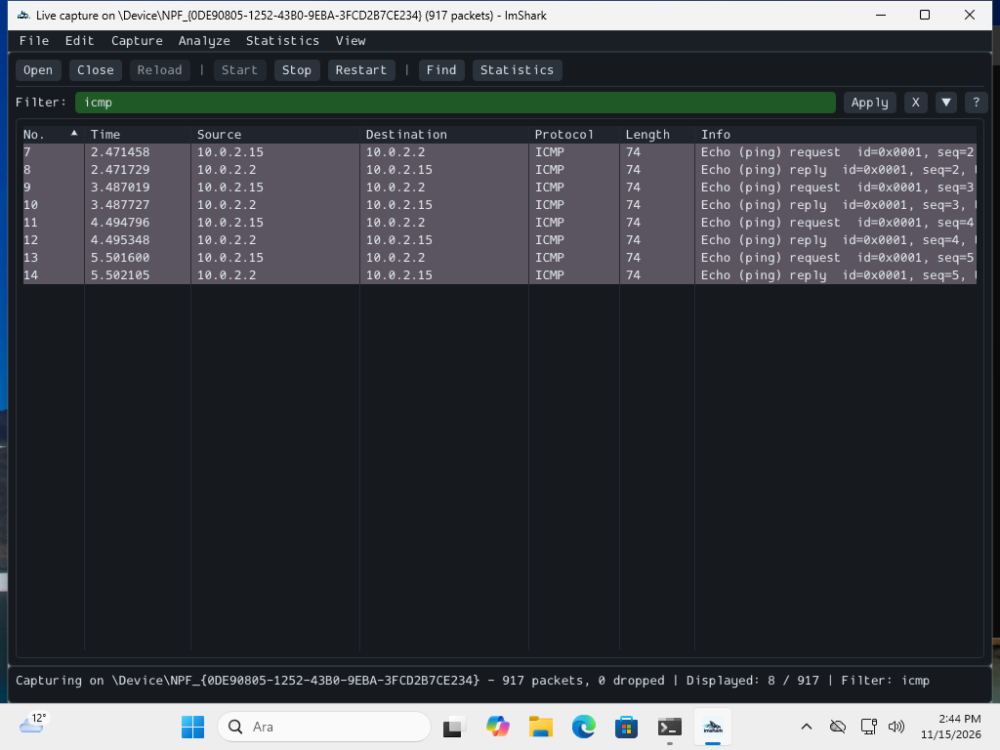
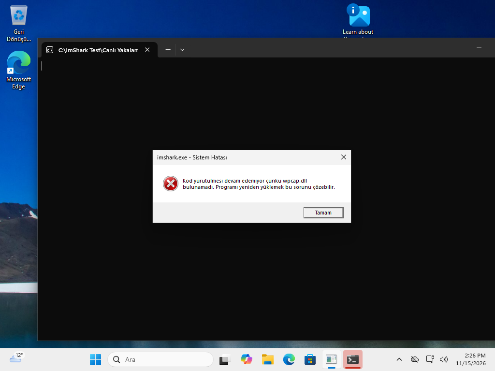
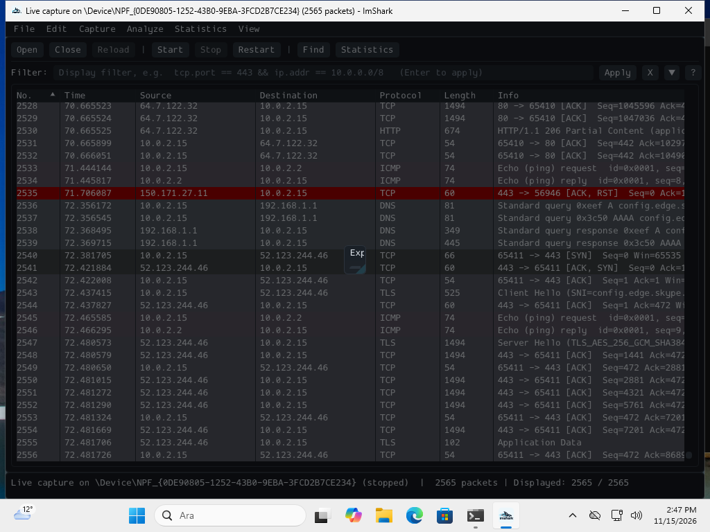
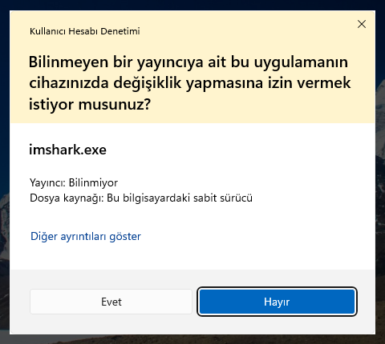

# Windows capture validation

This record keeps two things apart: the automated native Windows IPC evidence of 20 October 2026, and the
[run with a real Npcap driver and real UAC prompts](#real-npcap-and-interactive-uac-run--15-november-2026) of
15 November 2026. The second run found defects; what is still open is listed at the end. The published 1.0.0 ZIP is
still an offline-analysis build.

## Native IPC checks — 20 October 2026

### Source and environment

- Original Windows implementation: `3c42d756c0448c4b4418087a043efb390a1b98bc` (local source after the 1.0.0 release).
- Tested capture code: `18c2d0a2793e045cb2b88adc19b23f862f9873c2` on `codex/windows-capture-validation`.
- [Windows Actions run](https://github.com/Zaryob/imshark/actions/runs/39474798160), workflow `.github/workflows/windows-capture.yml`.
- GitHub `windows-2025`, x86_64, MSVC 19.51.36260.0, Windows SDK 10.0.26100.0.
- Npcap SDK 1.16, downloaded from the vendor with SHA-256 verification (hash pinned in the workflow).
- No driver is installed by this workflow. The native scenarios use synthetic packet sources and real Windows pipes
  and child processes; they do not open a network interface or a real authorization prompt.

### Automated results

| Check | Result |
|---|---|
| Standalone native IPC executable, using the production capture/worker/stream code | Passed |
| Npcap-enabled capture backend, compiled and linked against the SDK import library | Passed; executable not run with a driver |
| Twelve native IPC scenarios, repeated ten times | 120 scenario runs, zero failures (4.72 seconds total) |
| Default offline Windows application and capture/documentation regressions | Application built; 19 selected CTest checks passed, zero skips/failures (2.01 seconds) |
| macOS Release build and capture/documentation regressions after the changes | 81 selected tests: 78 passed, 3 skipped, zero failures (3.97 seconds) |

The twelve scenarios cover: exact pcap bytes, one-byte input chunks, malformed/truncated streams retaining earlier
packets, cancellation before connection, stopping an idle connected reader, connection timeout, prompt handling of a
failed authorization producer, a client connecting before the server waits, repeated session restarts, the real worker
stream writer's snap length and timestamps, an idle worker noticing GUI disconnection, and child-process arguments
including empty values and an executable path with spaces and `İ`.

The failed authorization scenario injects a failed process starter; it does **not** test rejection of a real UAC dialog.
The saved-pcap comparison checks the capture writer, not the GUI export/reopen flow.

The native log ends with:

```text
Native IPC scenarios: 12, failed: 0
```

CTest executes the native executable ten times with `--repeat until-fail:10`. Logs are uploaded as the
`windows-capture-validation` artifact on the linked run. `windows-offline-regressions` holds the separate default-build logs.

The macOS skips are the optional UI-cost benchmark (no fixture supplied), the disabled-backend test (not applicable to
this live-capture build), and the permission-dependent live loopback test. They are not successful driver checks.

### Corrections made during verification

- Keep the UTF-16 executable path alive until `ShellExecuteExW` returns, and remove an invalid `SpawnResult` member access.
- Quote empty Windows command-line arguments, including an empty BPF filter, so worker arguments retain their positions.
- Read an overlapped Named Pipe with an `OVERLAPPED` operation and wait for cancelled connection/read operations to
  finish before releasing their event and stack state. See Microsoft's [ReadFile contract](https://learn.microsoft.com/en-us/windows/win32/api/fileapi/nf-fileapi-readfile).
- Notice a failed producer before waiting out the connection timeout and preserve its failure message.
- Check idle-worker disconnection with a zero-byte write on the write-only handle; `PeekNamedPipe` needs read access.
- Drain buffered worker output before a clean source EOF; immediate client closure can otherwise lose unread packets.
- Remove the unsupported `npcap-users` group command from the documentation and setup guidance; use Npcap's documented admin-only behavior.
- Make zero uid/gid parser expectations platform-specific; Windows does not use POSIX uid/gid privilege dropping.
- Separate the packet-consumer adapter from the recorder so native IPC tests can link the production recorder without
  pulling in the dissector/UI stack. The normal application still uses the same consumer function.

### Reproduce native IPC checks

From an x64 Visual Studio developer PowerShell:

```powershell
cmake -S tools/windows_capture_validation -B build-windows-capture -G Ninja -DCMAKE_BUILD_TYPE=Release "-DNPCAP_SDK_DIR=C:/Npcap SDK"
cmake --build build-windows-capture
ctest --test-dir build-windows-capture --output-on-failure --repeat until-fail:10
```

The standalone project uses no vcpkg dependencies. With `NPCAP_SDK_DIR`, it also builds `npcap_link_check` to verify the
Npcap-enabled backend's compilation and linkage; CTest runs the offline IPC executable. In the normal project,
`windows_capture_native_ipc` is included in CTest on Windows.

The tested source commit above precedes the final documentation and setup-guidance wording changes; the latter were
also compiled in the local macOS application and do not change the tested IPC logic.

At the time of these checks no run with a real driver existed. Neither an SDK link check nor the native IPC result above
is evidence for the driver, desktop and package scenarios; those are covered by the run below.

## Real Npcap and interactive UAC run — 15 November 2026

The [Windows live capture checklist](RELEASING.md#10-windows-live-capture-checklist) was run with an installed Npcap
driver and real UAC prompts. Capturing real traffic, authorization through UAC and export work. The run also found
defects, listed under [Findings](#findings); the checklist items they affect stay open.

### Source and environment

| | |
|---|---|
| Date | 15 November 2026 |
| Source | The capture code of `9fbbc8c7282d`, with the IPv6 option fix and the packaging change of finding 1 on top |
| Package | `imshark-1.0.0-win64.zip`, 4 980 570 bytes, SHA-256 `5a7915ff82769581e7687586cc00e90ccbd580ed739cfe8e3c0938c0ad6d97d0`, configured with `IMSHARK_LIVE_CAPTURE=ON` |
| Build | [Actions run 43706414125](https://github.com/Zaryob/imshark/actions/runs/43706414125): GitHub `windows-2025`, x86_64, MSVC 19.51.36260.0, Npcap SDK 1.16 (hash pinned) |
| Test machine | Windows 11 Home Arm64, build 26300.9457, Turkish, in VirtualBox 7.2.22 on Apple Silicon. The x86_64 program runs under x64 emulation. Red Hat VirtIO Ethernet adapter behind NAT (10.0.2.15). Microsoft's OpenGL compatibility pack is installed. |
| Driver | Npcap 1.90 from npcap.com (installer SHA-256 `682b57e1c05ef375931975c9d6ded40888f4bfdf9f4b11571e654f962f1199b6`, signed by Nmap Software LLC), loopback support on |
| Npcap options | Installed three ways during the run: default (not restricted to Administrators, WinPcap API-compatible mode on); restricted to Administrators; WinPcap API-compatible mode off |
| Account | Member of Administrators with standard UAC; ImShark was always started unelevated |

This is not an x86_64 machine, so the run does not replace one on real x86_64 hardware.

The steps were scripted: synthetic mouse and keyboard input inside the guest, UAC prompts answered through the virtual
keyboard, results read from screenshots and from the process, pipe and file lists of the guest. The exported files were
copied out and compared with an independent pcap/pcapng parser on another machine.

### Results

| Checklist item | Result |
|---|---|
| Record source, Windows version, architecture, compiler, SDK and driver versions, admin-only setting | Done: table above |
| Launch from a path with spaces and non-ASCII characters; DLL discovery | **Partly failed.** Starts from `C:\ImShark Test\Canlı Yakalama\…\bin` when Npcap is in WinPcap API-compatible mode: it loads `System32\wpcap.dll`, which Npcap forwards to `wpcap_x64.dll` on Arm64. With that mode off the program does not start (finding 2). |
| Enumerate interfaces; capture known traffic directly | **Passed.** Ethernet and loopback are listed. Four pings and one HTTP request were sent; the display filter `icmp` shows exactly the 8 echo packets. 917 packets, 0 dropped, one process, not elevated. |
| Restricted access: the permission error offers **Authorize and capture**; accept UAC | **Partly passed.** On loopback: the error dialog offers it, UAC is accepted, the 6 packets of three pings arrive through the helper and its pipe, and the GUI stays unelevated. The Ethernet adapter cannot be reached this way (finding 5). |
| Reject UAC | **Passed.** "Administrator elevation failed: Authorization cancelled by the user" within 2 seconds, no wait for the pipe timeout. |
| Cancel while awaiting authorization or pipe connection | **Partly checked.** Escape on the UAC prompt gives the same prompt error and leaves no helper process and no pipe. The Cancel button of ImShark's own waiting window cannot be reached while the UAC secure desktop is shown, so it was not exercised. Cancelling during pipe connection was not exercised. |
| Stop an idle capture and a busy one; restart repeatedly | **Passed for direct capture.** Stopping during 20 pings froze the counter at 2565 packets; an idle loopback capture stopped at once; four restarts each began at 0 packets with one process. With the helper: one stop, after which helper and pipe were gone within 3 seconds. Repeated restarts with the helper were not run. |
| Valid BPF filter and short snap length; invalid filter | **Passed.** Filter `icmp` and snap length 64 (the field raises a typed 60 to its minimum): 600-byte pings and an HTTP request gave 6 packets, all ICMP, 64 of 642 bytes captured. `tcp port abc` is marked invalid while typing, and Start answers "Invalid capture filter: unknown port 'abc'". |
| Export to pcap and pcapng, reopen both, compare | **Passed, after working around finding 4.** For a 2565-packet and a 6-packet capture both formats hold the same packet count, captured and original lengths, microsecond timestamps and bytes. ImShark reopens the four files with the same counts. |
| Close the GUI during capture: worker exit, temporary files, unsaved-capture prompt | **Passed.** Closing asks about the unsaved packets (Export Packets, Discard, Cancel). Cancel keeps capturing. Discard exits and removes the session's temporary folder; with the helper running it also ends the helper and removes the pipe. Choosing Export Packets stops the capture first. |
| Repeat without an installed driver; default offline build | **Failed for the live capture build:** it does not start (finding 2). The default build without live capture does not import `wpcap.dll`; the published 1.0.0 package ran on this machine before Npcap was installed. |
| Add dated results and logs | This section |




### Findings

1. **A live capture build could not be packaged.** `cpack` stopped with "Could not resolve runtime dependencies:
   wpcap.dll" ([run 43705032668](https://github.com/Zaryob/imshark/actions/runs/43705032668)): the install rule collects
   every DLL the executable imports, and Npcap is not on the build machine. Fixed in the commit before this record by
   leaving `wpcap.dll` and `Packet.dll` out of that search; Npcap may not be redistributed anyway.
2. **A live capture build does not start unless `wpcap.dll` is on the normal DLL search path.** `wpcap.dll` is an
   ordinary import (no delay loading) and the program does not add `System32\Npcap` to the search path. Without Npcap,
   and with Npcap installed without WinPcap API-compatible mode, Windows shows its system error dialog (on this Turkish
   system "wpcap.dll bulunamadı", that is, wpcap.dll was not found) and `imshark.exe --version` exits with `0xC0000135`. Such a build cannot even open a capture file on
   a machine without Npcap. Not fixed.

   
3. **The tests of a live capture build cannot run on a machine without Npcap**, for the same reason: test discovery of
   `imshark_tests.exe` ends with `0xc0000135` (run 43706414125). CI therefore cannot test this configuration. Not fixed.
4. **The file dialog of Export Packets opens about 30 pixels wide on first use.** It has to be enlarged by dragging its
   corner before a name can be typed. `Display("ExportDlgKey")` in `src/ui/export_dialog.cpp` passes no minimum size,
   unlike the Open dialog. The same call without a size is in `follow_window.cpp` and `preferences.cpp`; those dialogs
   were not opened in this run. This is not specific to Windows or to live capture. Not fixed.

   
5. **With Npcap restricted to Administrators, Npcap asks for elevation itself, and ImShark's own authorization cannot
   reach a real adapter.** Opening Capture > Interfaces makes Npcap show a UAC prompt for its "helper program for
   Admin-only Mode". If that is answered Yes, the Ethernet adapter is listed and captures directly, with no further
   prompt. If it is answered No, only the loopback adapter is listed for the rest of the session, so **Authorize and
   capture** can only be used on loopback. The documentation describes ImShark's UAC helper as the route for this
   case; in practice Npcap's own prompt is. Not fixed.

   

   
6. **The Windows permission error names the macOS and Linux requirements** ("capturing needs access to /dev/bpf*
   (macOS) or CAP_NET_RAW (Linux)"), followed by Npcap's own text. Not fixed.
7. **ImShark's UAC prompt says "Unknown publisher"**, because the executable is not signed.

   

Smaller observations:

- An exported pcap file states a snap length of 262144 in its header and the pcapng interface block states 0, also for
  a capture taken with snap length 64.
- On the welcome screen **Start live capture...** opens the interface dialog the first time and starts at once on the
  last used interface afterwards.
- A session's temporary folder (`%TEMP%\imshark_…`) is removed on a normal exit. The folder of a process that was
  killed stays, and nothing removes it later.
- A console window opens next to the GUI when it is started from Explorer.

### Still open

- The whole checklist on a real x86_64 Windows machine.
- Findings 2 to 6.
- Repeated restarts with the helper, cancelling during pipe connection, and the Cancel button of ImShark's waiting
  window.
- The [clean-machine ZIP checklist](RELEASING.md#9-windows-clean-machine-checklist) on x86_64.

A failed or unexecuted item remains open in the checklist.
