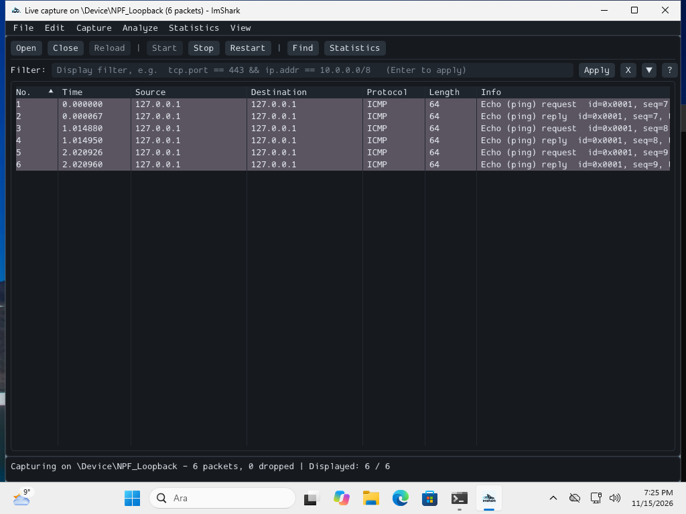
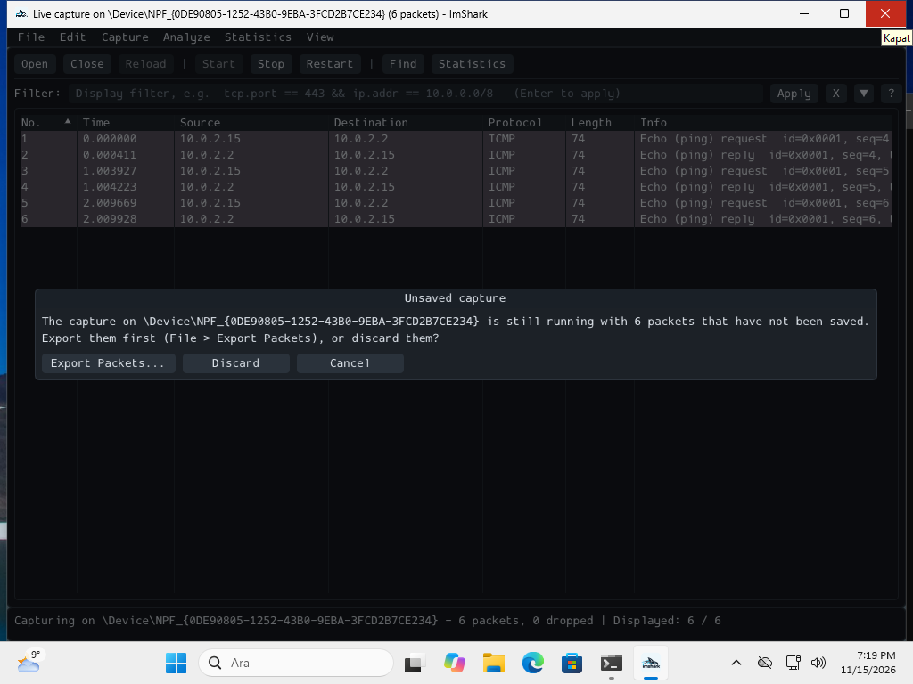
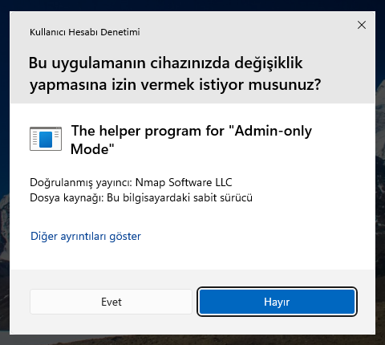
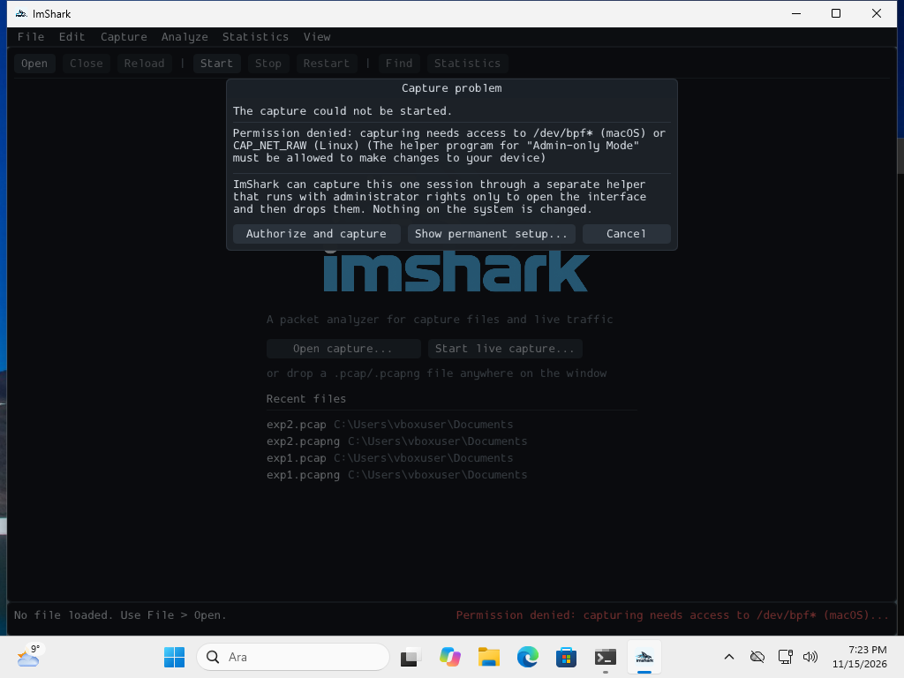
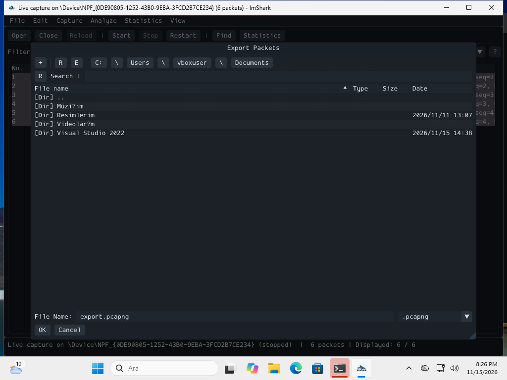
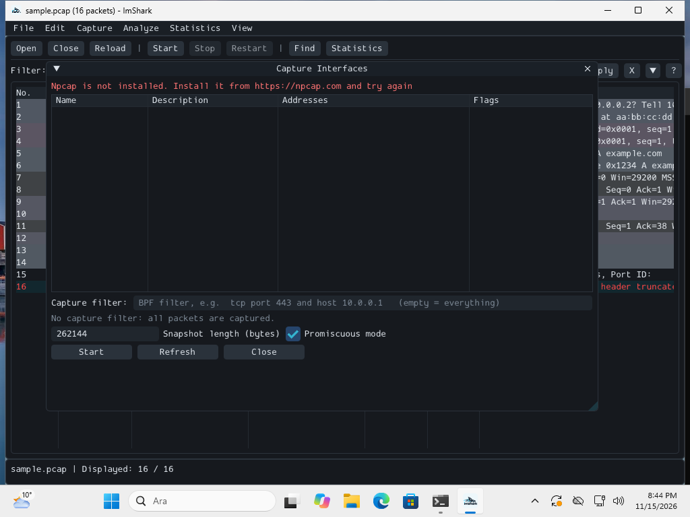

# Windows capture validation

Two sets of results: native IPC tests run in CI on 20 October 2026, and a run with the Npcap driver and real UAC
prompts on [15 November 2026](#driver-and-uac-run-15-november-2026). The published Windows ZIP is an offline-analysis
build and is not covered here.

## Native IPC checks — 20 October 2026

### Source and environment

- Original Windows implementation: `3c42d756c0448c4b4418087a043efb390a1b98bc` (local source after the 1.0.0 release).
- Tested capture code: `18c2d0a2793e045cb2b88adc19b23f862f9873c2` on `codex/windows-capture-validation`.
- [Windows Actions run](https://github.com/Zaryob/imshark/actions/runs/39474798160), workflow `.github/workflows/windows-capture.yml`.
- GitHub `windows-2025`, x86_64, MSVC 19.51.36260.0, Windows SDK 10.0.26100.0.
- Npcap SDK 1.16, downloaded from the vendor with SHA-256 verification (hash pinned in the workflow).
- No driver is installed by this workflow. The native scenarios use synthetic packet sources and real Windows pipes
  and child processes; they do not open a network interface or a real authorization prompt.

### Automated results

| Check | Result |
|---|---|
| Standalone native IPC executable, using the production capture/worker/stream code | Passed |
| Npcap-enabled capture backend, compiled and linked against the SDK import library | Passed; executable not run with a driver |
| Twelve native IPC scenarios, repeated ten times | 120 scenario runs, zero failures (4.72 seconds total) |
| Default offline Windows application and capture/documentation regressions | Application built; 19 selected CTest checks passed, zero skips/failures (2.01 seconds) |
| macOS Release build and capture/documentation regressions after the changes | 81 selected tests: 78 passed, 3 skipped, zero failures (3.97 seconds) |

The twelve scenarios cover: exact pcap bytes, one-byte input chunks, malformed/truncated streams retaining earlier
packets, cancellation before connection, stopping an idle connected reader, connection timeout, prompt handling of a
failed authorization producer, a client connecting before the server waits, repeated session restarts, the real worker
stream writer's snap length and timestamps, an idle worker noticing GUI disconnection, and child-process arguments
including empty values and an executable path with spaces and `İ`.

The failed authorization scenario injects a failed process starter; it does **not** test rejection of a real UAC dialog.
The saved-pcap comparison checks the capture writer, not the GUI export/reopen flow.

The native log ends with:

```text
Native IPC scenarios: 12, failed: 0
```

CTest executes the native executable ten times with `--repeat until-fail:10`. Logs are uploaded as the
`windows-capture-validation` artifact on the linked run. `windows-offline-regressions` holds the separate default-build logs.

The macOS skips are the optional UI-cost benchmark (no fixture supplied), the disabled-backend test (not applicable to
this live-capture build), and the permission-dependent live loopback test. They are not successful driver checks.

### Corrections made during verification

- Keep the UTF-16 executable path alive until `ShellExecuteExW` returns, and remove an invalid `SpawnResult` member access.
- Quote empty Windows command-line arguments, including an empty BPF filter, so worker arguments retain their positions.
- Read an overlapped Named Pipe with an `OVERLAPPED` operation and wait for cancelled connection/read operations to
  finish before releasing their event and stack state. See Microsoft's [ReadFile contract](https://learn.microsoft.com/en-us/windows/win32/api/fileapi/nf-fileapi-readfile).
- Notice a failed producer before waiting out the connection timeout and preserve its failure message.
- Check idle-worker disconnection with a zero-byte write on the write-only handle; `PeekNamedPipe` needs read access.
- Drain buffered worker output before a clean source EOF; immediate client closure can otherwise lose unread packets.
- Remove the unsupported `npcap-users` group command from the documentation and setup guidance; use Npcap's documented admin-only behavior.
- Make zero uid/gid parser expectations platform-specific; Windows does not use POSIX uid/gid privilege dropping.
- Separate the packet-consumer adapter from the recorder so native IPC tests can link the production recorder without
  pulling in the dissector/UI stack. The normal application still uses the same consumer function.

### Reproduce native IPC checks

From an x64 Visual Studio developer PowerShell:

```powershell
cmake -S tools/windows_capture_validation -B build-windows-capture -G Ninja -DCMAKE_BUILD_TYPE=Release "-DNPCAP_SDK_DIR=C:/Npcap SDK"
cmake --build build-windows-capture
ctest --test-dir build-windows-capture --output-on-failure --repeat until-fail:10
```

The standalone project uses no vcpkg dependencies. With `NPCAP_SDK_DIR`, it also builds `npcap_link_check` to verify the
Npcap-enabled backend's compilation and linkage; CTest runs the offline IPC executable. In the normal project,
`windows_capture_native_ipc` is included in CTest on Windows.

The tested source commit above precedes the final documentation and setup-guidance wording changes; the latter were
also compiled in the local macOS application and do not change the tested IPC logic.

These checks used no driver and no real UAC prompt.

## Driver and UAC run, 15 November 2026

Checklist: [Windows live capture checklist](RELEASING.md#10-windows-live-capture-checklist).

| | |
|---|---|
| Package | `imshark-1.0.0-win64.zip` with `IMSHARK_LIVE_CAPTURE=ON`, from [Actions run 43706414125](https://github.com/Zaryob/imshark/actions/runs/43706414125) (windows-2025, MSVC 19.51.36260.0, Npcap SDK 1.16); SHA-256 `5a7915ff82769581e7687586cc00e90ccbd580ed739cfe8e3c0938c0ad6d97d0` |
| Source | `9fbbc8c7282d` plus the IPv6 option fix and the packaging fix in problem 1 |
| Windows | Windows 11 Home, build 26300.9457, Arm64, Turkish, in VirtualBox 7.2.22. The x86_64 build runs under x64 emulation. |
| Network | VirtIO Ethernet adapter behind NAT, 10.0.2.15 |
| Npcap | 1.90 (installer SHA-256 `682b57e1c05ef375931975c9d6ded40888f4bfdf9f4b11571e654f962f1199b6`), loopback support on. Tried with the default options, restricted to Administrators, and without WinPcap API-compatible mode. |
| Account | Administrator with UAC; ImShark started unelevated |

This was not an x86_64 machine, so the checklist still has to be run on one. Exported files were also read with a
second pcap/pcapng parser.

### Results

| Item | Result |
|---|---|
| Path with spaces and non-ASCII characters; DLL loading | Partly failed. Started from `C:\ImShark Test\Canlı Yakalama\…` with Npcap's default options. Without WinPcap API-compatible mode it did not start (problem 2). |
| Interface list and direct capture | Passed. Ethernet and loopback were listed. With four pings and an HTTP request running, the `icmp` display filter showed the 8 echo packets; 917 packets, none dropped. |
| Restricted access: Authorize and capture, accept UAC | Partly passed. On loopback, the 6 packets of three pings came through the helper and the GUI stayed unelevated. The Ethernet adapter could not be used this way (problem 5). |
| Reject UAC | Passed. "Authorization cancelled by the user" within 2 seconds. |
| Cancel during authorization or pipe connection | Partly done. Escape at the UAC prompt gave the same error and left no helper or pipe. ImShark's own Cancel button and cancelling during the pipe connection were not tried. |
| Stop and restart | Passed for direct capture: stopping during traffic froze the count at 2565, an idle capture stopped at once, four restarts began at 0. Through the helper only one stop was tried; helper and pipe were gone within 3 seconds. |
| BPF filter and snap length | Passed. `icmp` with snap length 64 gave 6 ICMP packets of 642 bytes with 64 captured. `tcp port abc` was flagged while typing and Start reported "unknown port 'abc'". The field raises values below 64 to 64. |
| Export to pcap and pcapng | Passed, after enlarging the file dialog (problem 4). For a 2565-packet and a 6-packet capture both formats had the same counts, lengths, timestamps and bytes, and reopened with the same counts. |
| Closing during a capture | Passed. The unsaved-capture prompt appears. Cancel keeps capturing; Discard exits, ends the helper and removes the pipe and the session's temporary folder. |
| No driver installed | Failed: the live capture build did not start (problem 2). The offline 1.0.0 package does not need Npcap. |






### Problems found

1. Packaging failed: `cpack` could not resolve `wpcap.dll`
   ([run 43705032668](https://github.com/Zaryob/imshark/actions/runs/43705032668)). Npcap may not be redistributed, so
   `wpcap.dll` and `Packet.dll` are now left out of the DLL collection. Fixed.
2. The live capture build did not start when `wpcap.dll` was not on the DLL search path, that is without Npcap or with
   Npcap installed without WinPcap API-compatible mode. Windows reported that `wpcap.dll` was not found and
   `--version` exited with `0xC0000135`. Fixed, see below.

   
3. For the same reason the tests of that build could not run in CI
   ([run 43706414125](https://github.com/Zaryob/imshark/actions/runs/43706414125)). Fixed.
4. The Export Packets file dialog opened about 30 pixels wide the first time. The Save Stream and TLS key log dialogs
   used the same code. Fixed.

   
5. With Npcap restricted to Administrators, Npcap shows its own UAC prompt when the interface list is read. Accepting
   it lists the Ethernet adapter, and capture works with no further prompt. Declining it leaves only loopback for the
   rest of the session, so **Authorize and capture** cannot reach the real adapter. Open.

   

   
6. On Windows the permission error described the macOS and Linux requirements. Fixed.
7. The UAC prompt for `imshark.exe` shows an unknown publisher because the executable is not signed. Open.

   

Other notes:

- Exported files record a snap length of 262144 (pcap) or 0 (pcapng), also for a capture made with 64.
- After the first use, **Start live capture...** on the welcome screen starts on the last interface without showing the
  dialog.
- The temporary folder of a killed process is not removed later.
- A console window opens next to the GUI when it is started from Explorer.

### After the fixes

Problems 2, 3, 4 and 6 were fixed the same day and checked on the same machine with the package from
[run 43737763420](https://github.com/Zaryob/imshark/actions/runs/43737763420) (SHA-256
`f3b9aaf6983f21905576385a356a21be34280cb94c82b99b07efe0e52988d1c5`):

- `wpcap.dll` is delay loaded, from `System32\Npcap` or the system directory by full path.
- All file dialogs open at the size of the Open dialog.
- The Windows permission error refers to Npcap.

| Npcap | Result |
|---|---|
| Default options | Starts without loading Npcap; the first capture loads it from `System32\Npcap`. Three pings gave 6 packets. The export dialog opens at full size. |
| Without WinPcap API-compatible mode | Starts and captures the same 6 packets. The earlier build did not start here. |
| Not installed | `--version` exits with 0 and a capture file opens. The interface dialog and Start report "Npcap is not installed". |

In CI the tests of the live capture build run again without Npcap
([run 43740843862](https://github.com/Zaryob/imshark/actions/runs/43740843862)); the three tests that need libpcap are
skipped there.





### Open items

- Run the checklist on x86_64 hardware.
- Problems 5 and 7.
- The new permission error text has not been seen on screen yet.
- Repeated restarts through the helper, ImShark's own Cancel button during authorization, and cancelling during the
  pipe connection.
